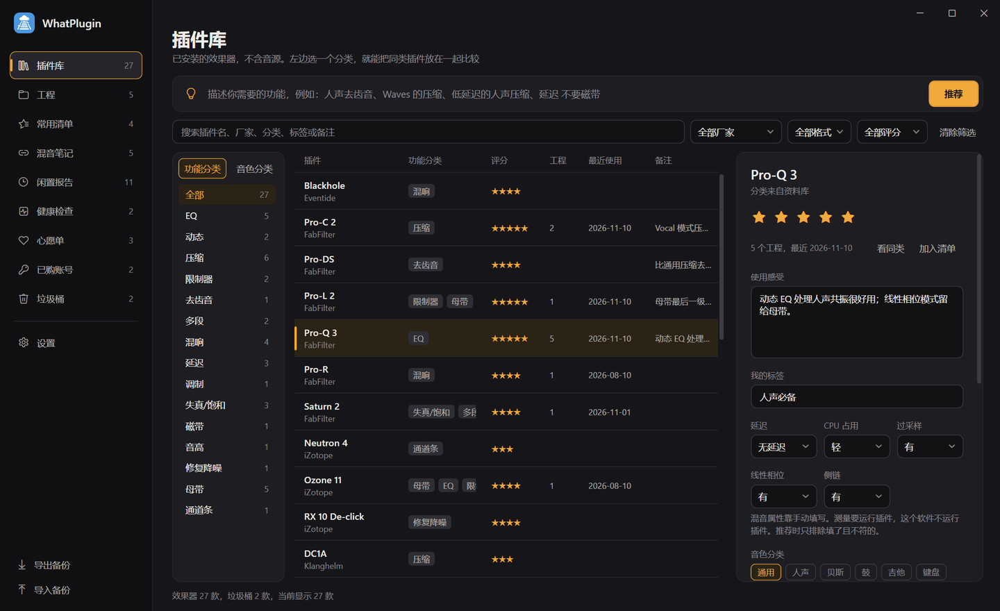
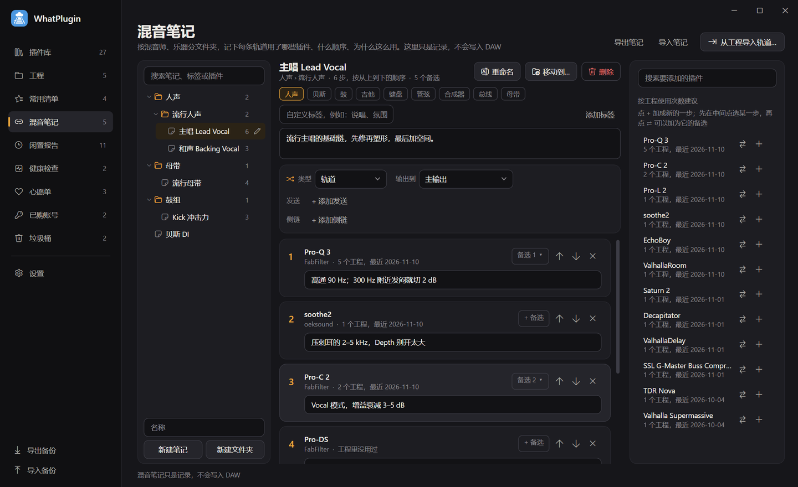
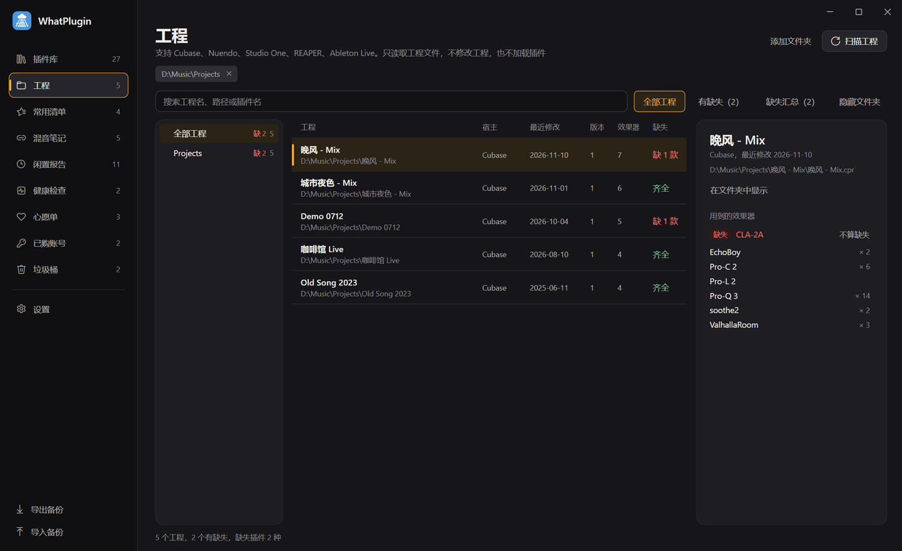
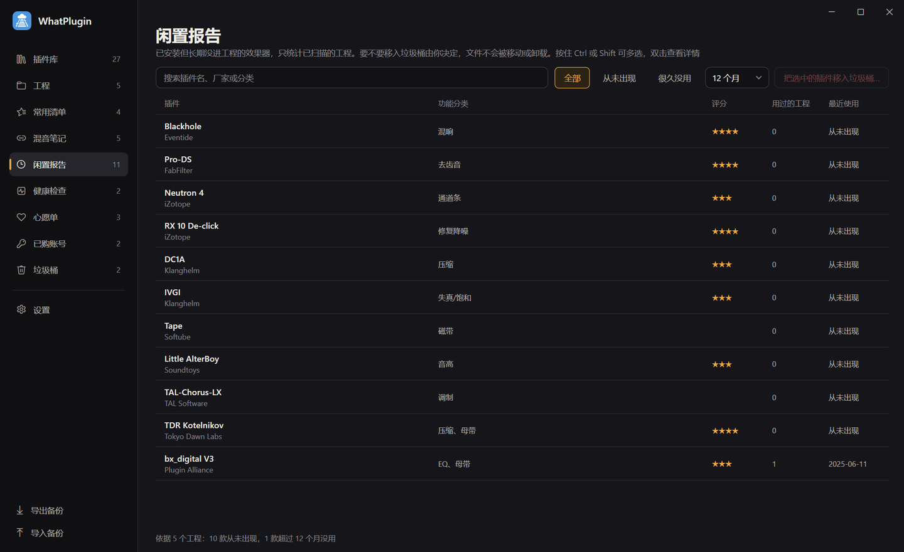
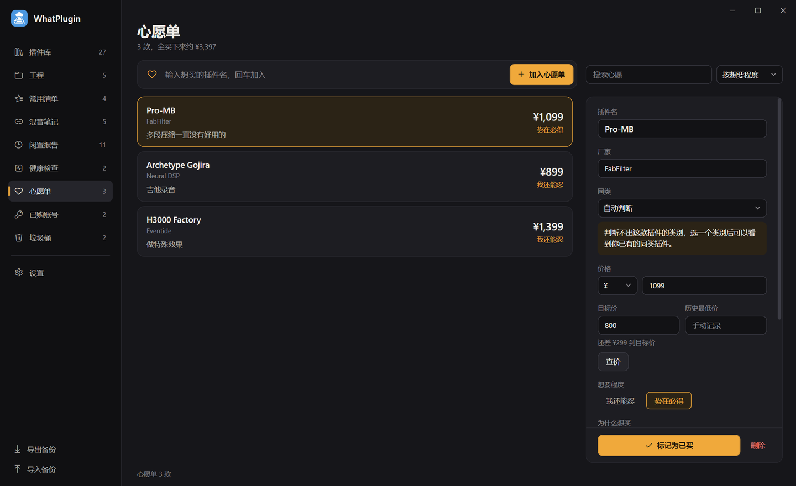
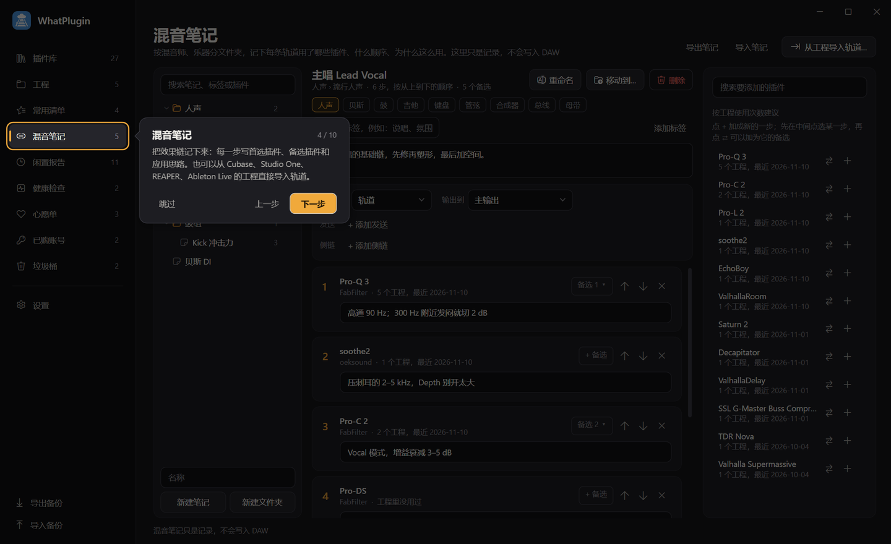

<div align="center">


# WhatPlugin

**给音乐人和混音师的音频插件管理软件**

装了多少插件、哪些在用、哪些吃灰、哪个账号买的、工程缺了什么，一个软件管清楚。

[](https://github.com/ChuiFeng-wind/What-Plugin/releases/latest)


[](LICENSE)

[下载安装](#下载安装) · [用户手册](docs/manual/WhatPlugin-用户手册.pdf) · [界面预览](#界面预览) · [功能一览](#功能一览) · [隐私与安全](#隐私与安全) · [常见问题](#常见问题) · [English](#english)

<br>



</div>

---

## 为什么做这个

插件只会越装越多：

- 打开半年前的工程，弹出一排“找不到插件”，不知道缺的是哪家的；
- 想重装某个插件，翻遍邮箱也想不起当时用哪个账号买的；
- 打折季买回一款插件，才发现去年就因为太吃 CPU 把它卸了；
- 一百多个插件里，真正常用的可能只有二三十个。


## 下载安装

到 [Releases 页面](https://github.com/ChuiFeng-wind/What-Plugin/releases/latest) 下载最新版：

| 文件 | 说明 |
| --- | --- |
| `WhatPlugin-Setup-<版本>-with-Achievements.exe` | 完整安装包，**带成就页面**（推荐） |
| `WhatPlugin-Setup-<版本>.exe` | 完整安装包，不带成就 |
| `WhatPlugin-Achievements-<版本>.exe` | 单独的成就包，给装了不带成就版本的人补装 |

- 系统要求：Windows 10 / 11，64 位。
- 升级时直接覆盖安装，插件资料、笔记、心愿单都会保留。
- 安装包没有数字签名，Windows 可能提示“Windows 已保护你的电脑”，点“更多信息” → “仍要运行”即可。
- 安装时如果 DAW 开着并且加载过 WhatPluginLookup，安装程序会提示你先关闭 DAW，或者跳过这次查询插件的更新。

第一次打开时有欢迎页和逐项导览，跟着走一遍就能上手。完整的使用说明见 **[用户手册（PDF）](docs/manual/WhatPlugin-用户手册.pdf)**，每个版本的 Release 里也附了一份。

> 从 1.2.6 及以前升级：软件改名为不带空格的 WhatPlugin，安装程序会自动把旧的 `What Plugin` 目录搬到 `WhatPlugin`，单独装的成就包一起带过去，旧的查询插件和快捷方式自动清理。数据不受影响。

## 界面预览

> 截图里是演示数据。

<table>
  <tr>
    <td width="50%"><br><b>混音笔记</b>：效果链的每一步写首选、备选插件和思路</td>
    <td width="50%"><br><b>工程分析</b>：每个工程用了哪些插件，缺了哪个一眼看到</td>
  </tr>
  <tr>
    <td width="50%"><br><b>闲置报告</b>：从没在工程里出现过、很久没用的插件</td>
    <td width="50%"><br><b>心愿单</b>：想要程度、目标价，离目标价还差多少</td>
  </tr>
  <tr>
    <td colspan="2"><br><b>新手指引</b>：第一次打开时逐项介绍每个页面</td>
  </tr>
</table>

## 功能一览

### 扫描插件
- 自动找出电脑上的 VST3 和 VST2 插件，读出名称、厂家和分类。
- 每个插件在单独的进程里读取，只读插件清单，不打开插件界面，**不会弹授权窗口**，也不会占用声卡。一个插件崩溃或卡死，只影响它自己。
- 自带厂家目录，约 154 个厂家、5000 多个产品名，扫完自动认出厂家。
- VST2 分不出效果器还是音源时，会参考 Cubase / Nuendo、REAPER、FL Studio、Cakewalk、Studio One 留下的插件记录。

### 插件库
- 按功能分类（EQ、压缩、混响…）或适合的音色分类（人声、贝斯、鼓、吉他…）浏览，同类插件放在一起比较。
- 给插件写笔记、打分、打标签、收藏；标记免费、已购或其他来源，已购的可以记发票号。
- 按用途、延迟、CPU 负载、侧链等条件筛选。

### 健康检查
- 找出重复安装、只有 32 位、残留 32 位副本、VST2 / VST3 版本对不上、被宿主拉黑、读取失败、文件丢失等问题。
- 只检查，不改动任何文件；附带按厂家查更新的入口。

### 工程分析
- 读取 DAW 工程文件（**只读，不修改**），列出每个工程用到的插件，汇总缺失的插件。
- 统计每个插件在工程里用了多少次；闲置报告列出很久没用、和从来没出现过的插件。

### 混音笔记
- 每条笔记是一条效果链：每一步写首选插件、多个备选插件，以及应用思路。没装的插件标“未安装”，可以一键加进心愿单。
- 多层文件夹整理（比如 混音师 › 鼓组 › Kick），可以加人声、鼓、总线、母带等标签。
- 从 DAW 工程直接导入轨道，按插槽顺序变成笔记：Cubase / Nuendo、Studio One、REAPER、Ableton Live。（目前仅实测过Cubase，其他DAW若有问题欢迎提issue）
- 记录音频路由：输出、发送、编组、效果轨，以及 Cubase 侧链，可以画出整个文件夹的路由图。
- 笔记可以单独导出分享，不包含工程名和路径；导入的笔记放进单独文件夹，不会覆盖你自己的。

### 常用清单
- 按笔记标签自动整理（比如“人声 常用”），按插件在笔记里出现的次数排序；也可以自己建清单。

### DAW 内查询插件（WhatPluginLookup）
- 一个 VST3 小插件，挂在 DAW 里就能查看插件的笔记和推荐，不用切出去。
- 只读取数据，音频原样通过，不增加延迟。

### 已购账号
- 记录每个厂家用哪个账号购买，同一厂家默认共用一个账号，也可以给单个插件另设。
- 一键把 iLok 账号填到所有用 iLok 激活的厂家上。
- 密码和序列号用 Windows DPAPI 加密保存，不以明文写入数据库。

### 心愿单
- 记录想买的插件和想要程度（我还能忍 / 势在必得），有查价、查更新的入口，并根据你已有的插件推荐同类。
- **加入以前丢进垃圾桶或卸载过的插件时，会提醒你当时为什么不要它、打了几分。**

### 垃圾桶与卸载历史
- 不想要的插件移进垃圾桶（只在软件里隐藏），在垃圾桶里可以直接卸载。
- 卸载日期、方式和原因记进卸载历史，插件记录删了也还在。
- Waves 卸载工具（**测试中**）：清理 Waves 的残留文件，删除前先列出清单，你确认后才删。
  > ⚠️ 这个工具还在测试阶段，不保证能完全卸载干净。使用前请自行备份；如出现卸载不干净等问题，作者不承担责任。

### 备份、分享与成就
- 完整备份和恢复：插件资料、心愿单、账号、设置、评价和清单。选择包含账号密码时，这部分用你设的备份密码加密（AES-256-GCM）。
- 插件评价可以单独导出、导入，和朋友交换使用心得。
- 可选安装的成就包：52 个成就，根据这台电脑上的数据解锁，不联网。成就包随安装包免费提供，源码不公开（见[许可](#许可)）。
- 左侧导航可以拖动排序，6 套深色 / 浅色主题。

## 隐私与安全

- **所有数据只保存在你的电脑上**（`%LOCALAPPDATA%\WhatPlugin\plugins.db`），软件不上传任何数据。
- 工程文件只读，不会被修改。
- 不读取、不修改 iLok / PACE 授权数据。
- 扫描插件不打开插件界面，不改动插件文件；卸载、清理这类会动文件的操作，都会先列出清单由你确认。
- 使用统计（给成就包用）只记日期和次数，不记路径、账号和你写的文字，可以在设置里关闭或清空。

## 常见问题

**扫描会不会把插件扫坏，或者弹一堆授权窗口？**
不会。扫描在单独的进程里只读插件清单，不创建插件实例，不弹授权窗口。

**会改我的工程吗？**
不会。工程分析和导入轨道都只读工程文件。

**卸载软件会删掉我的数据吗？**
不会。数据库留在 `%LOCALAPPDATA%\WhatPlugin\`。换电脑时用软件里的“导出备份”迁移。

**Waves 卸载工具靠谱吗？**
它还在测试中，不保证完全有效，可能有残留没清掉。建议先用 Waves Central 正常卸载，再用它清理残留，并提前备份。如出现卸载不干净等问题，作者不承担责任。

**支持 Mac 吗？**
目前只支持 Windows 10 / 11（64 位）。

**有问题或建议怎么反馈？**
欢迎在 [Issues](https://github.com/ChuiFeng-wind/What-Plugin/issues) 里提，附上软件版本和操作步骤会更快定位。

## 从源码构建

需要 .NET 10 SDK；编译 `scanner/` 和 `plugin/` 还需要 CMake 和 Visual Studio C++ 工具链，`plugin/` 另外需要 JUCE；打安装包需要 Inno Setup 6。

```bash
dotnet build src/WhatPlugin.App/WhatPlugin.App.csproj -c Release -r win-x64
dotnet test tests/WhatPlugin.Tests -c Release
pwsh installer/build.ps1   # 先跑测试，再输出安装包到 dist\
```

公开源码里没有成就包，所以自己构建只会得到不带成就的安装包 `WhatPlugin-Setup-<版本>.exe`，其余功能完整。

```
src/WhatPlugin.Core/          核心逻辑：扫描、数据库（SQLite）、工程解析、厂家目录、备份加密
src/WhatPlugin.App/           WPF 图形界面
src/WhatPlugin.Cli/           命令行工具，也给 DAW 内的查询插件提供数据
scanner/                      C++ 扫描进程，在独立进程里读取 VST3 清单
plugin/                       DAW 内查询插件（C++ / JUCE）
installer/                    Inno Setup 安装脚本和打包脚本
tests/                        单元测试
```

## 更新记录

| 版本 | 主要内容 |
| --- | --- |
| 1.2.7 | 改名为 WhatPlugin（去掉空格）：安装目录、查询插件、快捷方式都不再带空格，老版本升级时自动搬家；新增 PDF 用户手册 |
| 1.2.6 | 第一次公开发布。新增新手指引：首次打开的欢迎页和左侧导航逐项导览 |
| 1.2.5 | 卸载历史和卸载原因；修复 DAW 开着时安装报“拒绝访问” |
| 1.2.4 | 混音笔记单独导出、导入；左侧导航自定义顺序 |
| 1.2.3 | 卸载过的插件保留评价，再加入心愿单时提醒 |
| 1.2.2 | 音频路由和路由图；新增带成就的完整安装包 |
| 1.2.0 | 可选安装的成就包 |
| 1.1.x | 混音笔记、常用清单、Waves 卸载工具、厂家目录、完整备份 |

## 许可

本仓库的源码以 [GNU 通用公共许可证第 3 版（GPL-3.0）](LICENSE) 发布：可以自由使用、学习、修改和再发布，但再发布修改后的版本时，必须同样以 GPL-3.0 公开全部源码。

成就包（`WhatPlugin.Achievements`）不在本仓库中，也不在 GPL-3.0 范围内。它以编译好的形式包含在带成就的安装包和单独的成就包里，可以免费使用，© 2026 ChuiFeng-wind 保留所有权利。

DAW 内查询插件使用 JUCE 构建，第三方组件的许可见 [installer/THIRD-PARTY-NOTICES.txt](installer/THIRD-PARTY-NOTICES.txt)。

---

## English

**WhatPlugin** is a Windows app for musicians and mix engineers to manage their audio plugins.

- **Scan** VST3 / VST2 plugins in an isolated process: no license pop-ups, no audio device, one crashing plugin doesn't stop the scan. Vendors are recognized from a built-in catalog of ~150 vendors.
- **Library & health check**: browse by function or by source (vocal, drums…), rate and tag plugins, find duplicates, 32-bit leftovers and broken files.
- **Project analysis** (read-only): see which plugins each project uses, what's missing, and which plugins you never use.
- **Mix notes**: save effect chains with alternatives and reasoning, import tracks from Cubase / Nuendo, Studio One, REAPER and Ableton Live, and look them up inside your DAW with the WhatPluginLookup VST3.
- **Accounts, wishlist and trash**: remember which account bought what (passwords encrypted with DPAPI), and get reminded why you uninstalled a plugin before you buy it again.

- **Waves uninstall tool (experimental)**: cleans up leftover Waves files after you confirm the list. It is still in testing and is not guaranteed to remove everything; use it at your own risk — the author is not responsible for incomplete uninstalls.

All data stays on your computer. Project files are never modified, and iLok / PACE license data is never read or changed.

Requires Windows 10 / 11 (x64). Download from [Releases](https://github.com/ChuiFeng-wind/What-Plugin/releases/latest). The UI is currently in Chinese only; a full [user manual (PDF, Chinese)](docs/manual/WhatPlugin-用户手册.pdf) is included. Since 1.2.7 the app is named WhatPlugin (no space); upgrading from older versions moves the install folder automatically.

Source code in this repository is licensed under [GPL-3.0](LICENSE). The optional achievements pack is not part of this repository; it ships as a free, closed-source binary in the installers.
